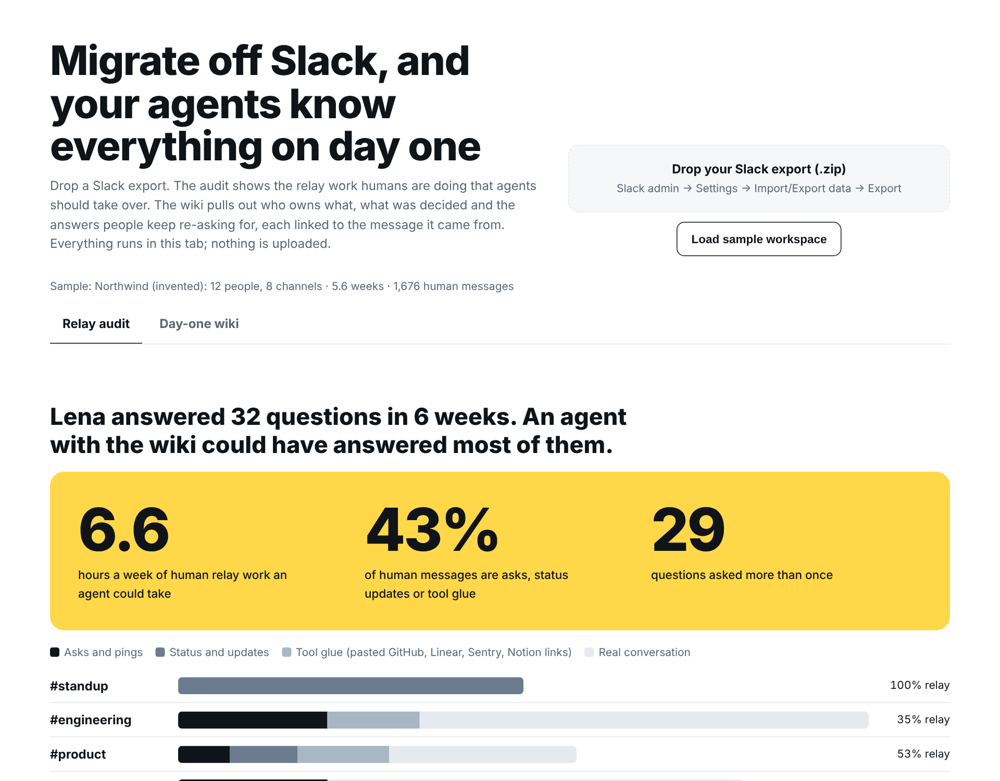
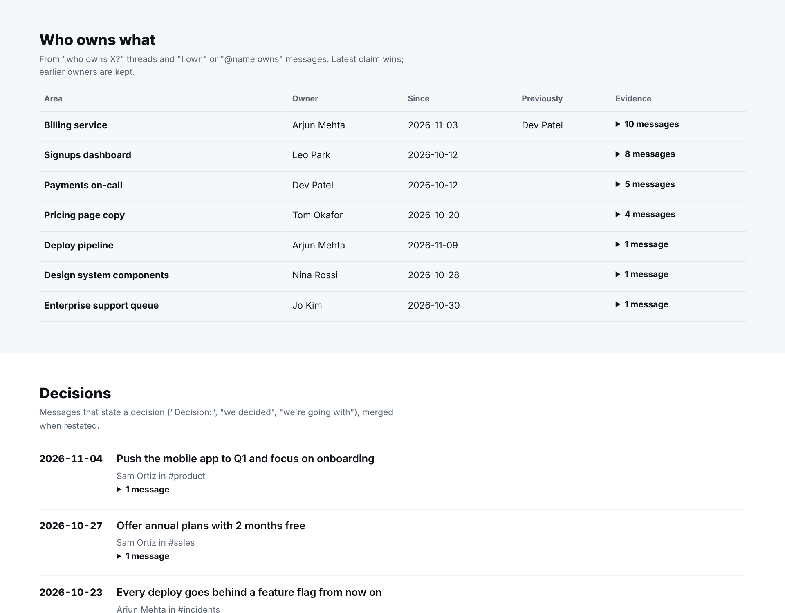

# slack-to-ando

[](https://github.com/SAZ14/slack-to-ando/actions/workflows/pages.yml)

**Migrate off Slack, and your agents know everything on day one.**

Drop a Slack workspace export into the page and get two things:

1. **Relay audit.** How much of your Slack is humans doing an agent's job (asks, pings, status updates, pasted tool links), channel by channel, plus the agents you'd hire to take it over.
2. **Day-one wiki.** Who owns what, what was decided and the answers people keep re-asking for, pulled out of the export. Every line links back to the Slack messages it came from, so a person or an agent can check it.

**▶ Live demo: https://saz14.github.io/slack-to-ando/** (opens on a sample workspace, no upload needed)

Everything runs in your browser. The export is read locally and never leaves the tab. There is no server.

| Relay audit | Day-one wiki |
|---|---|
|  |  |

> Unofficial side project built for the [Ando](https://www.ando.so) team. Not affiliated with Ando.

## Tested on real Slack data

Beyond the synthetic sample, the tool was run on **460,065 real messages** from four public Slack communities (Python, Clojure, Elm, Racket; MSR 2020 dataset). It processes the largest export, 259k messages, in about 2 seconds in the browser. On held-out random samples, **55%** of wiki answers correctly answer their question and **36%** of repeat-question groups are true repeats. The test exposed bugs in owner and question detection, which are fixed. Full method, every labeled example, and what's still weak: **[EVALUATION.md](EVALUATION.md)**.

## Why

Ando's bet is that agents should be teammates in the same channels as humans, sharing context. Two things make that hard to adopt:

- Teams don't see how much of their chat is relay work until someone counts it. The audit counts it.
- On day one, a new agent knows nothing that's buried in years of Slack history. The wiki gives it a starting memory, with sources, the same way Ando's workspace memory links changes back to the messages they came from.

## What it extracts

| | How | Example from the sample |
|---|---|---|
| **Asks and relay work** | Question and request patterns, `@mentions` on questions, status-update language, messages that are just a pasted GitHub, Linear, Sentry or Notion link | 43% of human messages |
| **Repeat questions** | Jaccard similarity on question wording | "How do I reset SSO?" asked 14× in 3 phrasings |
| **Human routers** | Who gets pinged on asks and who answers in their threads | Lena answered 32 questions in 6 weeks |
| **Agent roster** | Per-channel mix of incident chatter, PR asks, status posts and repeat questions | Answer agent, digest agent, PR shepherd, incident triage |
| **Ownership** | "who owns X?" threads, "I own X", "@name owns X", on-call statements. The latest claim wins and earlier owners are kept | Billing service: Arjun (previously Dev) |
| **Decisions** | "Decision:", "we decided", "we're going with", merged when restated | "14-day trial, no card required" (restated 4×) |
| **FAQ** | The most recent substantive thread answer per question cluster. "On it" and "+1" are ignored, and an older answer that disagrees is flagged as superseded | "Who owns billing?" → Arjun, with Dev's earlier answer flagged |

Optional extras:
- **Permalinks:** enter your workspace URL (`yourteam.slack.com`) and every source becomes an "open in Slack" link.
- **Markdown export:** download or copy the wiki as `wiki.md`.

## Try it

- **Hosted:** open the demo and drop in your export (Slack admin → Settings → Import/Export data → Export).
- **Sample data:** [`sample/northwind-slack-export.zip`](sample/northwind-slack-export.zip) is a synthetic workspace (12 people, 8 channels, 6 weeks) in Slack's real export format. Regenerate it with `npm run sample`.
- **Locally:**
  ```bash
  npm install
  npm run serve        # http://localhost:8000
  npm test             # parser, audit and wiki tests against the sample export
  node scripts/print-wiki.mjs path/to/export.zip yourteam.slack.com   # wiki as Markdown in the terminal
  ```

## How it's built

Plain JavaScript modules with no build step and no framework.

```
index.html        page shell (two tabs: #audit, #wiki)
src/parse.js      Slack export zip → users, channels, messages
src/audit.js      message classification, repeat-question clustering, routers, agent roster
src/wiki.js       ownership, decisions, FAQ, Markdown export
src/ui.js         rendering and events
sample/           synthetic export and its generator
tests/            node:test suite
```

`parse.js`, `audit.js` and `wiki.js` have no DOM dependencies, so the same code runs in the browser and in Node, and could run inside an agent or an import pipeline.

## Limitations

- Extraction is heuristic (regular expressions and wording similarity), not a language model. It favors precision: an entry needs an explicit claim, decision phrase or substantive answer. Every entry shows its sources so mistakes are easy to spot.
- It reads public-channel exports only. DMs and private channels aren't in a standard export.
- Hours saved is an estimate, and its assumptions can be adjusted on the page.
- Tuned on English-language workspaces.

## License

MIT
